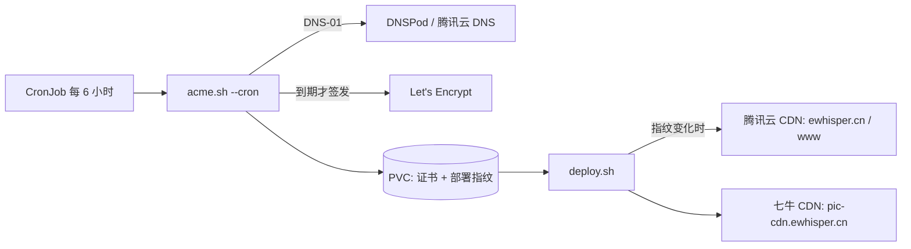

# Certificate management

Certificates are generated and managed by [Tailscale HTTPS](https://tailscale.com/kb/1153/enabling-https) with [Let's Encrypt](https://letsencrypt.org).

- To enable HTTPS for Tailscale, you need a TLS certificate from a public Certificate Authority (CA), which can be obtained through the Tailscale admin console.
- To provision TLS certificates for devices in your tailnet, you need to enable MagicDNS and HTTPS Certificates in the admin console, then run tailscale cert on each machine to obtain a certificate.
- TLS certificates are issued based on your tailnet name and are recorded in the Certificate Transparency (CT) public ledger, which includes the fully qualified domain name of your devices.
- Certificates provided by Let's Encrypt have a 90-day expiry and require periodic renewal, which can be done automatically or manually depending on the integration used.
- You can disable HTTPS for your tailnet, but this will break all links and connections that relied on HTTPS, and certificates will not be revoked.

## [ Exposing cluster workloads using a Kubernetes `Ingress`](https://tailscale.com/kb/1439/kubernetes-operator-cluster-ingress#exposing-cluster-workloads-using-a-kubernetes-ingress)

You can expose cluster workloads either to your tailnet or the public internet over TLS using an`Ingress` resource. When using an `Ingress` resource, you also get the ability to identify callers using [HTTP headers](https://tailscale.com/kb/1312/serve#identity-headers) injected by the `Ingress` proxy.

`Ingress` resources only support TLS, and are only exposed over HTTPS using a [MagicDNS](https://tailscale.com/kb/1081/magicdns) name and publicly trusted certificates from LetsEncrypt. You must [enable HTTPS](https://tailscale.com/kb/1153/enabling-https) and [MagicDNS](https://tailscale.com/kb/1081/magicdns) on your tailnet.

Edit the `Ingress` resource you want to expose to use the `Ingress` class `tailscale`:

1. Set `spec.ingressClassName` to `tailscale`.
2. Set `tls.hosts` to the desired host name of the Tailscale node. Only the first label is used. See [custom machine names](https://tailscale.com/kb/1445/kubernetes-operator-customization#custom-machine-names) for more details.

For example, to expose an `Ingress` resource `nginx` to your tailnet:

```yaml hl_lines="11 14"
apiVersion: networking.k8s.io/v1
kind: Ingress
metadata:
  name: foo
  annotations:
    tailscale.com/proxy-group: ingress-proxies
spec:
  defaultBackend:
    service:
      name: foo
      port:
        number: 80
  ingressClassName: tailscale
  tls:
    - hosts:
        - foo
```

(Optional): `tailscale.com/proxy-group: ingress-proxies`

Currently the only supported [`Ingress` path type](https://kubernetes.io/docs/concepts/services-networking/ingress/#path-types) is `Prefix`. Requests for paths with other path types will be routed according to `Prefix` rules.

A Tailscale `Ingress` can **only** be accessed on port 443.

A much more detailed diagram can be found in the official documentation under:

- [Enabling HTTPS · Tailscale Docs](https://tailscale.com/kb/1153/enabling-https)
- [Kubernetes operator · Tailscale Docs](https://tailscale.com/kb/1439/kubernetes-operator-cluster-ingress)

## ewhisper.cn（acme.sh → 腾讯云 / 七牛 CDN）

`apps/acme-ewhisper` 是唯一一个**集群内没人消费证书**的证书应用：它用 acme.sh 给
`ewhisper.cn` 签一张多域名 Let's Encrypt 证书，续期后直接推给两家 CDN，集群里没有任何
Service 依赖它。

放在集群里跑而不是台式机的 crontab，是因为台式机会关机，而 CronJob 跟着集群一起常驻，
脚本也就和集群一起在 Git 里管理了。



| 项目 | 值 |
| --- | --- |
| 调度 | `11 0,6,12,18 * * *`（`Asia/Shanghai`），真签发时间由 ACME ARI 窗口决定 |
| 镜像 | `neilpang/acme.sh`；签名与部署只用镜像自带的 `curl`、`openssl`、`jq`，不额外装 tccli |
| 状态 | PVC `acme-ewhisper-data` 挂到 `/acme.sh`：账号密钥、证书、`fullchain.cer` 的部署指纹 |
| 脚本 | `apps/acme-ewhisper/files/{renew,deploy}.sh`，由 `templates/scripts.yaml` 装进 ConfigMap |
| 签发 | Let's Encrypt，DNS-01（`dns_tencent`） |
| 域名 | `ewhisper.cn`、`www.ewhisper.cn`、`pic-cdn.ewhisper.cn`（`pic.ewhisper.cn` 已于 2026-11-02 退役） |

### 机密

四把密钥来自 `external/terraform.tfvars` 的 `extra_secrets`（`make external` 后落在
`global-secrets` 命名空间的 `external` Secret），再由
`apps/acme-ewhisper/templates/secret.yaml` 只把用到的四项同步进应用命名空间：

| tfvars key | 用途 | 环境变量 |
| --- | --- | --- |
| `acme-ewhisper-tencent-secret-id` | DNSPod 签发 + SSL/CDN 部署 | `Tencent_SecretId` |
| `acme-ewhisper-tencent-secret-key` | 同上 | `Tencent_SecretKey` |
| `acme-ewhisper-qiniu-access-key` | 七牛证书上传与域名绑定 | `QINIU_ACCESS_KEY` |
| `acme-ewhisper-qiniu-secret-key` | 同上 | `QINIU_SECRET_KEY` |

私钥与证书只存在于 PVC 上，`acme.sh` 还会把腾讯密钥回写进 PVC 上的 `account.conf`，
两者都不进 Git。PVC 不备份：丢了只需要重签一次证书。

### 运维

```sh
# 最近一轮的日志（最后两行是 fullchain 的 sha256 和证书指纹）
kubectl -n acme-ewhisper logs job/$(kubectl -n acme-ewhisper get job -o name | tail -1 | cut -d/ -f2)

# 手动补跑一轮（改完脚本、或者想让 CDN 立刻更新时）
kubectl -n acme-ewhisper create job --from=cronjob/acme-ewhisper "manual-$(date +%s)"

# 三个 CDN 域名上实际在用的证书指纹，应与上面日志里的「证书指纹」一致
for h in ewhisper.cn www.ewhisper.cn pic-cdn.ewhisper.cn; do
  ip=$(getent ahostsv4 "$h" | awk 'NR==1{print $1}')
  printf '%s ' "$h"
  echo | openssl s_client -connect "$ip:443" -servername "$h" 2>/dev/null |
    openssl x509 -noout -fingerprint -sha256
done
```

### 已知坑

搬运自原来的 `acme-ewhisper-certs` 仓库，改脚本前先看一遍：

- 腾讯 `DeployCertificateInstance` 的实例格式是 `域名|计费开关`（`off` = 免费部署通道），数组参数要传 JSON。
- 腾讯 `UploadCertificate --Repeatable true` **不去重**：每次续期都会新增一条证书记录，Alias 固定为
  `ewhisper.cn-acme`，便于定期清理。
- 七牛是**双域名 + 双鉴权**：证书接口用 `QBox`（路径签名，body 不参与），域名配置用 `Qiniu`
  （`Method/Path/Host/Content-Type/X-Qiniu-Date` + 紧凑 JSON 整体签名）。
- Kodo「自定义源站域名」不支持 API 绑证书，所以 `pic.ewhisper.cn` 是退役而不是迁移。
- Let's Encrypt 重复签发上限 5 次/周，调试时不要反复 `--force`。
- **重跑是幂等的**：`deploy.sh` 用 `fullchain.cer` 的 sha256 当指纹，只有变化才推 CDN，
  所以 Job 失败重试、手动补跑都不会重复上传。

### 从台式机迁移

1. 把四把密钥加进 `global-secrets` 命名空间的 `external` Secret。写进 `external/terraform.tfvars`
   再 `make external` 是标准路径；但这个 Secret 最初是手建的、OpenTofu state 里没有它，所以也可以直接
   `kubectl -n global-secrets patch secret external --type=merge --patch-file <patch.json>` 合并这四个键
   ——**别整体替换**，里面的 `restic-*` 是 `scripts/backup` 在用的。
2. 合并后 ArgoCD 自动同步；第一轮 CronJob 会签发新证书并推到两家 CDN（旧证书并存到新证书生效，无中断）。
3. 用上面的日志和指纹确认线上已是新证书后，删掉台式机上的 crontab 行
   （`11 0,6,12,18 * * * ~/.acme.sh/acme.sh --cron ...`）。
   `~/.acme.sh` 目录可以留着手工排查，但不再需要调度。
