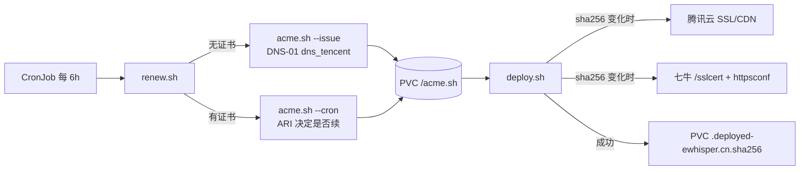

# 实施方案：ewhisper.cn 证书续期搬进集群 CronJob

**Date**: 2026-11-02 | **目标集群**: 生产 homelab2（ArgoCD 自动同步 `master`）
**来源**: 台式机 `~/.acme.sh` + crontab + 公开仓库 `east4ming/acme-ewhisper-certs`
**本次是否执行**: 是。用户已确认「放 homelab2 更合适，代码在 homelab2 repo 统一管理」。

---

## 1. 判定摘要

| 问题 | 现状 | 结论 |
| --- | --- | --- |
| 调度归属 | 台式机 crontab，机器会关机 | 换成集群 CronJob，跟随集群常驻 |
| 状态放哪 | `~/.acme.sh`（私有、单机） | PVC + `--config-home`，容器随时可重建 |
| 用什么镜像 | 台式机的 tccli + python3 环境 | 官方 `neilpang/acme.sh` 镜像（自带 dnsapi/curl/openssl/jq），不自建镜像 |
| 云端写入怎么保证幂等 | `--reloadcmd` 每次续期都跑，重试会重复上传 | 用 `fullchain.cer` 的 sha256 当指纹，**变了才推** |
| 机密怎么进集群 | 台式机本地文件 | ESO 从 `global-secrets/external` 注入四项；仓库只有占位符 |
| 证书谁消费 | 没人，只推到两家 CDN | 不生成集群内 TLS Secret |

## 2. 数据流

- 每轮都先 `renew.sh`：PVC 里没有 `ewhisper.cn/ewhisper.cn.conf` 就走 `--issue`，否则 `--cron`。
- 然后无条件跑 `deploy.sh`；它自己比对指纹，未变化直接退出。这样**失败重试**和**手动补跑**
  都会把云端补齐，而不会重复签发或重复上传。

## 3. 技术选型与取舍

| 选型 | 取了什么 | 为什么不取另一个 |
| --- | --- | --- |
| 镜像 | 官方 `docker.io/neilpang/acme.sh:3.1.6`，`AUTO_UPGRADE=0` | 自建镜像要在本仓库新增构建流水线；镜像自升级会绕过固定 tag |
| 部署脚本运行时 | 镜像自带 `curl` + `openssl` + `jq`，腾讯云 TC3 签名用 shell 实现（~40 行） | 用 `tccli` 需要 python 环境；用 python 需要自建镜像或启动时装包 |
| 触发 CDN 部署 | `renew.sh` 后固定调用 `deploy.sh` + 指纹判重 | `--reloadcmd` 失败后重试不会重跑（证书没变就不触发 reload），会静默留下旧证书 |
| 证书状态 | PVC `acme-ewhisper-data`（1Gi，RWO） | emptyDir 会导致每轮重签，撞 Let's Encrypt 5 次/周上限 |
| 机密 | `ExternalSecret` 显式 `data[]` 取四项 | `dataFrom.extract` 会把 `restic-*` 等无关密钥一起灌进应用命名空间 |
| 调度 | CronJob `11 0,6,12,18 * * *` + `timeZone: Asia/Shanghai` | 沿用 6 小时节奏，保持与原 crontab 同墙钟，便于对照日志 |
| 卡片形式 | bjw-s `app-template` 5.3.0 的 `type: cronjob` | 本仓库其它应用都是这个 chart；无状态服务才用 Deployment |

## 4. 机密设计

`external/terraform.tfvars`（本地、`*.tfvars` 已被忽略）四项 → `make external` 或直接
`kubectl -n global-secrets patch secret external --type=merge` → `global-secrets/external` →
`ExternalSecret`（`apps/acme-ewhisper/templates/secret.yaml`）只同步四项：

| tfvars key | 环境变量 | 用途 |
| --- | --- | --- |
| `acme-ewhisper-tencent-secret-id` | `Tencent_SecretId` | acme.sh `dns_tencent` 签发 + TC3 调用 SSL/CDN |
| `acme-ewhisper-tencent-secret-key` | `Tencent_SecretKey` | 同上 |
| `acme-ewhisper-qiniu-access-key` | `QINIU_ACCESS_KEY` | 七牛 `QBox` / `Qiniu` 两种鉴权 |
| `acme-ewhisper-qiniu-secret-key` | `QINIU_SECRET_KEY` | 同上 |

注意：这个 `external` Secret 里原有 `restic-*` 四项，`scripts/backup` 的 ExternalSecret 在读，
**只能 merge，不能整体替换**。

## 5. 文件清单

| 路径 | 作用 |
| --- | --- |
| `apps/acme-ewhisper/Chart.yaml` | app-template 5.3.0 依赖 |
| `apps/acme-ewhisper/values.yaml` | cronjob 控制器、镜像、PVC、ConfigMap 挂载 |
| `apps/acme-ewhisper/templates/scripts.yaml` | `.Files.Glob "files/*.sh"` → ConfigMap `acme-ewhisper-scripts` |
| `apps/acme-ewhisper/templates/secret.yaml` | ExternalSecret（四项） |
| `apps/acme-ewhisper/files/renew.sh` | 首签 / 续期分支，然后 exec 部署脚本 |
| `apps/acme-ewhisper/files/deploy.sh` | 指纹判重 + 腾讯云 SSL/CDN + 七牛证书与域名 |
| `external/terraform.tfvars.example` | 四个键的占位符与权限说明 |
| `scripts/backup-coverage` | 新 PVC 列入豁免（丢了重签即可） |
| `docs/concepts/certificate-management.md` | 链路、机密、运维命令、已知坑、迁移步骤 |

## 6. 验证计划（已执行）

| 验证 | 方式 | 结果 |
| --- | --- | --- |
| 渲染 | `helm dependency update` + `helm template`（检查 CronJob / PVC / ConfigMap / ExternalSecret / 挂载名） | 通过 |
| lint | `helm lint`、`pre-commit`（yamllint/shellcheck/helmlint/eof/detect-private-key）、`mkdocs build --strict` | 通过 |
| 脚本内容 | 渲染后的 ConfigMap 与 `files/*.sh` 逐字节 diff | 一致 |
| 腾讯云签名 | 用真实密钥对 `ssl:DescribeCertificates` 做**只读**调用 | HTTP 200（签名被接受） |
| 七牛签名 | 用真实 AK/SK 对 `GET /sslcert`（QBox）与 `GET /domain/<name>`（Qiniu）做只读调用 | 均 200 |
| 流程 | 在真实镜像里用 stub 的 `acme.sh` + `curl` 跑：首签、续期、跳过、API 报错、缺变量 | 退出码与指纹行为符合预期 |
| 机密 | `detect-private-key`、全仓库搜索真实密钥模式 | 无命中 |
| 线上写入 | **未执行**：当时线上三个域名的指纹已等于台式机本地证书，写入是空操作，用户明确拒绝 | — |

## 7. 风险与回退

- **首轮签发失败**：Job 非零退出并保留失败历史；DNS 传播慢时重试是安全的（`--cron` 不会重复签）。
- **PVC 误删**：下一轮自动重签；短期签发次数受 5 次/周限制。
- **CDN 部署部分成功**：指纹未写，下一轮重做；腾讯云会多一条证书记录（`Alias=ewhisper.cn-acme`）。
- **回退**：把 `apps/acme-ewhisper` 从 `master` revert 掉，ArgoCD `prune` 会删掉 CronJob/PVC；
  台式机 `~/.acme.sh` 与 crontab 在确认线上指纹之前**不要删**，这就是回退路径。

## 8. 上线与迁移顺序

1. 合并到 `master`（ArgoCD 自动同步，创建 namespace / ExternalSecret / ConfigMap / PVC / CronJob）。
2. 下一轮（或手动 `kubectl -n acme-ewhisper create job --from=cronjob/acme-ewhisper`）完成首签并推 CDN。
3. 对比日志里的「证书指纹」与三个域名的 `openssl s_client` 指纹。
4. 确认一致后，删掉台式机 crontab 那一行；`~/.acme.sh` 目录留着做排查，不再需要调度。
